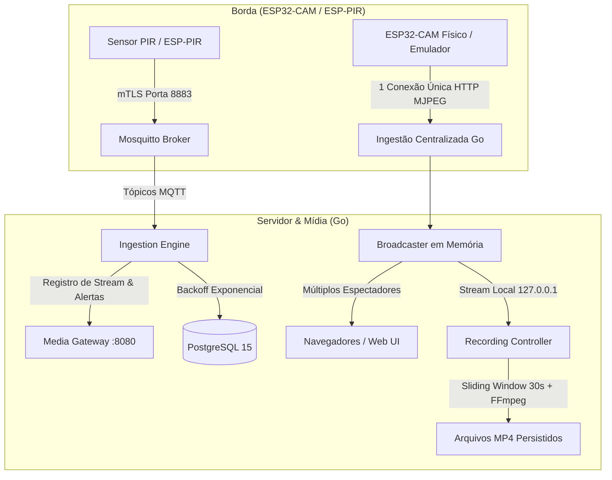

# SentinelNode 2.0 🛡️📹

**SentinelNode 2.0** é um ecossistema de vigilância pessoal e monitoramento de borda (IoT) de nível industrial, desenvolvido em Go e C++ para ESP32-CAM e servidores locais (ex: Proxmox LXC).

O sistema resolve de forma definitiva o problema de gargalo do ESP32-CAM (que suporta apenas 1 cliente de vídeo simultâneo), introduzindo **ingestão centralizada contínua com Broadcaster em memória**, **gravação orientada a eventos PIR com janela de tolerância deslizante (Sliding Window de 30s)** e uma **interface web de vigilância pessoal com player ao vivo e reprodução de gravações**.

---

## 🏗️ Arquitetura do Sistema Sentinel 2.0



---

## 🌟 Principais Recursos da Versão 2.0

1. **Ingestão Centralizada e Broadcaster Não-Bloqueante:**
   * O servidor mantém **apenas 1 conexão HTTP** com o ESP32-CAM, contornando o limite físico do chip.
   * Distribuição de vídeo MJPEG em memória para qualquer número de navegadores simultâneos.
   * Buffers limitados com descarte inteligente de frames para clientes lentos, garantindo que nenhum espectador trave a ingestão ou a gravação.
2. **Visualização ao Vivo Contínua:**
   * A transmissão ao vivo fica disponível a qualquer instante (`http://localhost:8080/` ou `/live`), mesmo quando não houver qualquer movimento detectado.
3. **Gravação Orientada a Eventos com Janela Deslizante (Sliding Window):**
   * Vídeos são gravados no disco **somente** quando o sensor PIR detecta presença.
   * Tolerância configurável de inatividade (padrão **30 segundos**). Cada novo evento PIR reinicia o temporizador sem fragmentar o vídeo em múltiplos arquivos.
   * Ao expirar a tolerância, o processo FFmpeg é encerrado graciosamente (sinal `q` no stdin), garantindo escrita perfeita dos índices MP4 (`moov` atom) sem corrupção.
4. **Interface Web Integrada:**
   * Painel responsivo em tema escuro servido diretamente pelo Go em `http://localhost:8080/`.
   * Player de vídeo ao vivo, telemetria em tempo real (FPS, frames ingeridos, espectadores), catálogo de gravações e player HTML5 com download de MP4.
5. **Comunicação Binária de Baixo Nível & mTLS:**
   * Broker Mosquitto operando em porta segura **`8883`** com autenticação mTLS baseada em certificados x509.
   * Protocolo binário customizado (`0x53 0x4E` - "SN") para máxima economia de banda em microcontroladores.
6. **Autonomia de Rede Local:**
   * 100% autônomo, operando localmente na LAN sem dependência de serviços em nuvem ou internet.

---

## 🚀 Como Executar

### 1. Inicializar Certificados (mTLS)
```bash
cd certs/
chmod +x generate_certs.sh
./generate_certs.sh
cd ..
```

### 2. Subir a Infraestrutura (Mosquitto & PostgreSQL)
```bash
docker compose up -d
```
*(Nota: O banco PostgreSQL está mapeado para a porta externa `5435` para evitar conflito com instâncias prévias na `5432`)*.

### 3. Iniciar o Media Gateway (Porta 8080)
```bash
cd media-gateway
go run main.go
```
* Acesse a interface web em: **`http://localhost:8080/`**
* Stream ao vivo para navegadores ou VLC: **`http://localhost:8080/live?device_id=esp32-cam-01`**

### 4. Iniciar o Ingestion Engine (Barramento MQTT + PostgreSQL)
```bash
cd ingestion-engine
go run cmd/main.go
```

---

## 🧪 Suíte de Testes Automatizados

O sistema conta com suíte abrangente cobrindo os 10 cenários obrigatórios de conformidade:

* **TESTE 1**: Live disponível sem movimento e sem persistência em disco.
* **TESTE 2**: Disparo de gravação ao receber evento PIR.
* **TESTE 3**: Eventos sucessivos reiniciam a tolerância sem duplicar arquivos ou processos.
* **TESTE 4**: Finalização correta da gravação após término da tolerância.
* **TESTE 5**: Manutenção da gravação ativa caso surjam novos eventos antes do timeout.
* **TESTE 6**: Múltiplos espectadores simultâneos consumindo da mesma câmera física.
* **TESTE 7**: Desconexão de um espectador não interrompe a gravação nem os demais espectadores.
* **TESTE 8**: Gravação autônoma funcionando mesmo sem espectadores conectados.
* **TESTE 9**: Identificação e recuperação automática de desconexão da câmera.
* **TESTE 10**: Encerramento gracioso do servidor (`SIGINT/SIGTERM`) sem arquivos corrompidos.

Para rodar todos os testes do projeto:

```bash
# Testes do Media Gateway (Broadcaster, Recorder e Integração)
cd media-gateway
go test -v ./...

# Testes do Ingestion Engine
cd ../ingestion-engine
go test -v ./...

# Testes do Edge Agent
cd ../edge-agent
go test -v ./...
```

---

## 📄 Licença
Distribuído sob a licença **MIT** - consulte o arquivo [LICENSE](LICENSE) para detalhes.
